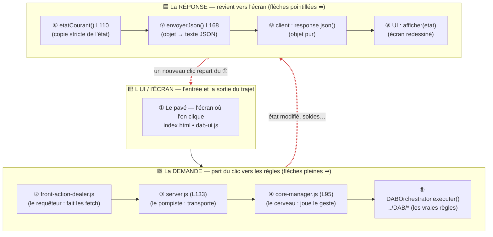
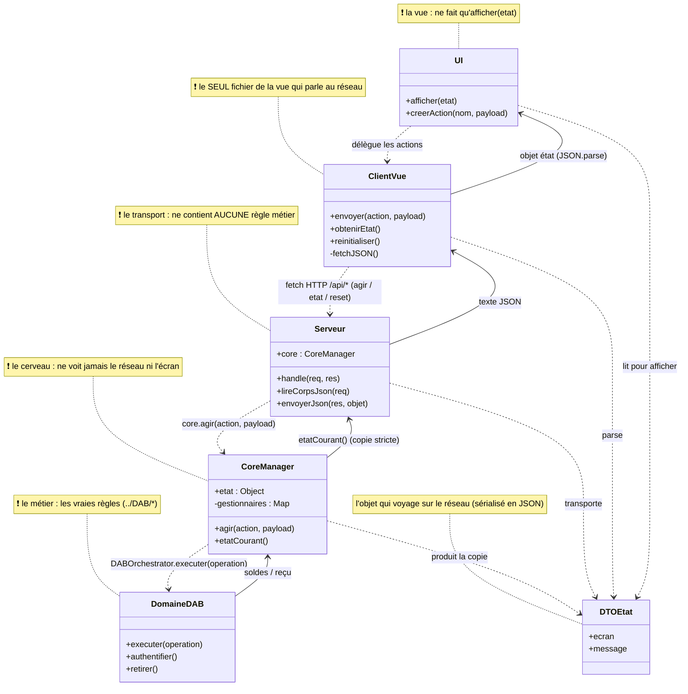
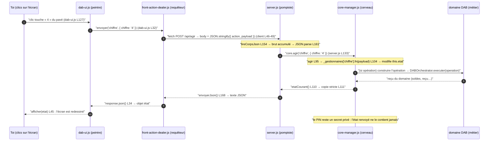
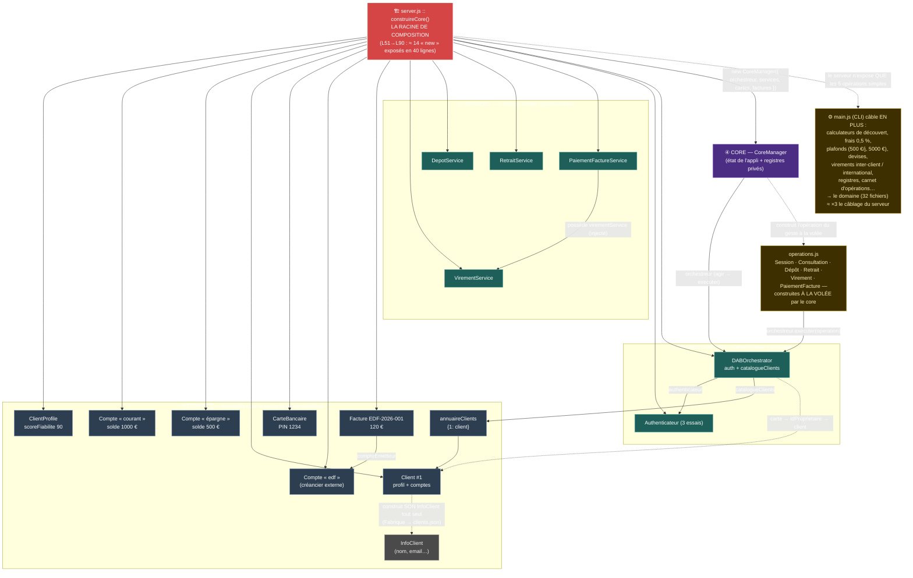

# DAB web — Architecture visuelle (Mermaid)

> Trois schémas complémentaires pour « voir » l'architecture :
> 1. **Le chemin de l'information** (flowchart) — suis un clic : 3 zones empilées, chacune lue **de gauche à droite**. En bas la **demande** (flèches pleines ①→⑤) part du clic vers les règles ; en haut la **réponse** (pointillés ⑥→⑨) revient vers l'écran ; au milieu **l'UI/l'écran** (①), d'où tout part et où tout revient. Le trajet est une **boucle** : écran → règles → écran.
> 2. **Le diagramme de classes** (classDiagram) — qui fait quoi, qui appelle qui, en une seule image statique.
> 3. **Le parcours dans le temps** (sequenceDiagram) — la version la plus fine, étape par étape.
>
> 📖 Le contrat textuel complet reste dans `../README.md`.

---

## 1. Le chemin de l'information — flowchart

> **Comment le lire** : chaque zone se lit **de gauche à droite**. Les flèches **pleines** (en bas) = la *demande* part du clic vers les règles. Les flèches **pointillées** (en haut) = la *réponse* revient vers l'écran. C'est une **boucle** : l'écran émet, les règles décident, l'écran affiche — puis un nouveau clic repart du ①.

**Légende des étapes (avec les lignes de code) :**

| Étape | Fichier : ligne | Ce qui se passe réellement |
|---|---|---|
| ① | index.html / dab-ui.js | tu cliques → dab-ui.js fabrique `{ action, payload }` |
| ② | front-action-dealer.js | `transmettre()` → `fetch POST /api/agir` (L46-49) |
| ③ | server.js **L124 → L133** | route `POST /api/agir` → `lireCorpsJson` L161 → `core.agir()` L133 |
| ④ | core-manager.js **L95 → L104** | `agir()` → `_gestionnaires[action].fn(payload)` → modifie `this.etat` |
| ⑤ | ../DAB/DABOrchestrator | si le geste implique une opération : construire + `executer(operation)` |
| ⑥ | core-manager.js **L110 → L111** | `etatCourant()` renvoie une **copie stricte** (deep clone) de l'état |
| ⑦ | server.js **L168** | `envoyerJson()` sérialise l'objet en texte JSON |
| ⑧ | front-action-dealer.js | `response.json()` → re-objet |
| ⑨ | dab-ui.js | `afficher(etat)` redessine l'écran |

> Le core ne connaît ni le réseau ni l'écran ; le serveur ne pense pas ; la vue ne décide rien.
> **Chaque fichier fait une seule chose**, et le contrat est toujours le même : `action + payload → core → nouvel état`.

---

## 2. Le diagramme de classes

> **Lecture** : les **boîtes** = fichiers / responsabilités ; **flèche pointillée** = « appelle / dépend de » ; **flèche pleine** = « renvoie des données à ». Les notes ❗ rappellent les règles d'or.

---

## 3. Le parcours dans le temps — sequence

> Le même voyage que la section 1, mais **instance par instance** : l'ordre exact des appels et des retours, avec les lignes de code qui vont avec.

> **À retenir** : quel que soit le geste ou l'écran, le contrat est toujours `action + payload → core → nouvel état`.

---

## 4. Où poser tes points d'arrêt (pour voir le voyage en vrai)

| Couche | Fichier : ligne | Ce que tu observeras (panneau Variables) |
|---|---|---|
| Pompiste | `server.js` **L133** | `corps.action` / `corps.payload` reçus du navigateur |
| Cerveau | `core-manager.js` **L95** | l'`action` et le `payload` entrent dans `agir(...)` |
| Cerveau | `core-manager.js` **L104** | le gestionnaire `entree` choisi pour ce geste |
| Cerveau | `core-manager.js` **L111** | `this.etat` juste avant le clonage (écran suivant) |

> ⚠️ Les fichiers de la vue (`index.html`, `dab-ui.js`, `front-action-dealer.js`) vivent **dans le navigateur** :
> le débogueur **F5** (Node) ne les traverse pas. Pour les voir : **F12 → Réseau** (les fetch) ou **F12 → Sources** (points d'arrêt navigateur).

---

## 5. Comment afficher ces schémas

- **GitHub** : ouvrez ce fichier `.md` — les blocs `mermaid` sont rendus automatiquement.
- **VS Code** : installez l'extension **« Markdown Preview Mermaid Support »** puis faites **Ctrl+Shift+V** sur ce fichier (*cmd+shif+v sur Mac*).
- **Sans rien installer** : collez le code d'un bloc dans **https://mermaid.live** (rendu instantané).
- **Sans Markdown du tout** : les 4 schémas sont pré-rendus en SVG dans ce dossier — `archiDAB_server.svg` / `archiDAB_hauteur.svg` (flowchart en 3 bandes), `archiDAB_classes.svg` (classes), `archiDAB_sequence.svg` (séquence), `archiDAB_cablage.svg` (câblage / dépendances) ; ouvrez-les dans un navigateur ou glissez-les dans un doc.

---

## 6. Le diagramme de câblage — « qui new qui » (l'envers du décor)

> Le schéma en 3 bandes (section 1) montre des **couches** ; celui-ci montre l'**assemblage réel** du serveur (`server.js :: construireCore()`, L51→L90 : ≈ 14 « new » en 40 lignes). Il révèle pourquoi le code paraît « fouilli » alors que l'architecture est simple :
> - une classe qui **se construit des objets elle-même** (le `Client` fabrique son `InfoClient`),
> - un service **composé dans un autre** (`PaiementFactureService` possède un `VirementService`),
> - le **core qui fabrique des opérations à la volée** (`operations.js`),
> - et un domaine (32 fichiers) environ **×3 plus gros** que ce que le serveur ne branche réellement (le reste est câblé par `main.js`).

> **À retenir** : chaque exécutable (serveur, `main.js`, `test-core-manager.js`) a **SA propre racine de composition** qui « new » son monde. Le serveur ne branche que **4 services opérationnels** — le reste du domaine (plafonnés, frais, découvert, devises, inter-client…) existe, fonctionne et se teste via `main.js`, mais reste hors de l'API.
